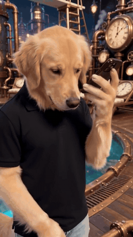
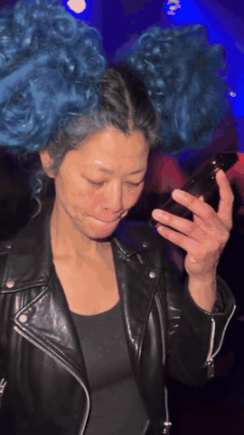
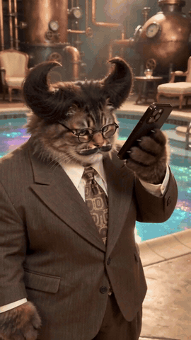

# How I Become a Millionaire meme — the ChatGPT “Get a job” skit

The script, the timing, where it came from, and how the AI remakes (your face or your pet's in the skit) are made.

**Short answer:** it's a comedy skit. Someone holds a phone to their mouth and asks, *“ChatGPT, how I become a millionaire in 30 days?”* The answer comes back — *“Get a job.”* — and they take it as an insult: *“Bro, what are they talking about?”* Since mid-October 2026 people have been remaking it with AI, putting their own face, a friend, a dog or a cat in the lead.

👉 **Make your own from one photo:** [howibecomeamillionaire.com](https://howibecomeamillionaire.com/?utm_source=github&utm_medium=referral&utm_campaign=readme)

| Dog | Solo | Cat |
|:---:|:---:|:---:|
|  |  |  |

*AI remakes made with HowIBecome. No footage from the original appears in them.*

---

## The script

The meme is the first 13 seconds of the original reel: four lines, one vertical handheld shot.

1. Phone up to the mouth, like a voice note: **“Chat… ChatGPT, ChatGPT, how I become a millionaire in 30 days?”**
2. He lowers the phone and stares at the screen, then reads the answer out loud, flat: **“Get a job.”**
3. Looks up at the camera, offended: **“Bro, what are they talking about?”**
4. Types angrily, then tries again: **“ChatGPT, what if you don't want to get a job and you want to be a millionaire?”**

It's “how **I** become”, not “how **do** I become” — the broken grammar is part of the joke, so most remakes keep it. The original caption also spells it “ChatGBT”.

## Where it comes from

- **The original:** a comedy reel by [@glowboynoah](https://www.instagram.com/reel/DdcULJkN4cw), posted on Instagram on **September 18, 2026**, captioned *“That one dude who ask ChatGBT everything.”* The full reel runs about a minute — he asks ChatGBT one silly question after another. The millionaire question is the first 13 seconds, and that's the part that became the meme.
- **The AI wave:** around **October 12, 2026**, AI versions started spreading on TikTok, often under [#chatgptmillionairetrend](https://www.tiktok.com/tag/chatgptmillionairetrend): same lines, same movement, a new face. Dogs and cats took over fast.
- **Search interest:** [Google Trends](https://trends.google.com/trends/explore?date=2026-09-25%202026-10-17&geo=US&q=how%20i%20become%20a%20millionaire) shows US searches for “how I become a millionaire” rising every day from October 12 to October 17, 2026.

## Why “Get a job.” is funny

The question asks for a shortcut; the answer is what a parent would say, in two words. A million dollars in 30 days is about **$33,333 a day**, every day — the arithmetic is the joke. What makes it a meme is the reaction: he isn't confused, he's insulted.

## Make your own

The remakes you see on TikTok keep the skit's movement, timing and original voice, and swap the person. On [HowIBecome](https://howibecomeamillionaire.com/?utm_source=github&utm_medium=referral&utm_campaign=readme) you upload one photo — of you, a friend who said yes, your dog or your cat — pick a background, and get the finished vertical 9:16 clip, lip-synced to the original sound, usually in about 5 minutes. Clips come in one-time packs with no subscription, and failed renders are refunded automatically.

## Tips for a good result

- One clear, front-facing photo, good light, no sunglasses.
- Only use your own face, or someone who said yes. No celebrities.
- For pets: the whole face visible, eyes open.
- When you post it, mark it as AI-generated — and don't present it as a real conversation with ChatGPT.

## FAQ

**Did ChatGPT really say “Get a job”?**
No. It's a comedy skit; the answer is written for the joke.

**Who made the original?**
The Instagram creator @glowboynoah, on September 18, 2026. Watch the [original reel](https://www.instagram.com/reel/DdcULJkN4cw).

**How long is the original video?**
About a minute. The meme is its first 13 seconds.

**Can I make it with my dog or cat?**
Yes — the pet stands in for the person, phone in paw, lip-synced to the original sound.

**Is there a free way?**
Film it yourself with the trend's sound in TikTok or CapCut. An AI remake with your face is rendered by a paid video model.

## More

- [The meme explained](https://howibecomeamillionaire.com/what-is-chatgpt-millionaire-meme)
- [The full script with timings](https://howibecomeamillionaire.com/chatgpt-millionaire-meme-script)
- [Best ChatGPT millionaire AI video makers, compared](https://howibecomeamillionaire.com/best-chatgpt-millionaire-ai-video-makers)
- [Can ChatGPT make you a millionaire in 30 days?](https://howibecomeamillionaire.com/can-chatgpt-make-you-a-millionaire)

---

HowIBecome is an independent fan tool. It is not affiliated with, endorsed or sponsored by OpenAI (ChatGPT is a trademark of OpenAI) or by the creator of the original skit. The original is linked, never re-uploaded.

Text in this README: [CC BY 4.0](https://creativecommons.org/licenses/by/4.0/). Example clips: © HowIBecome.
